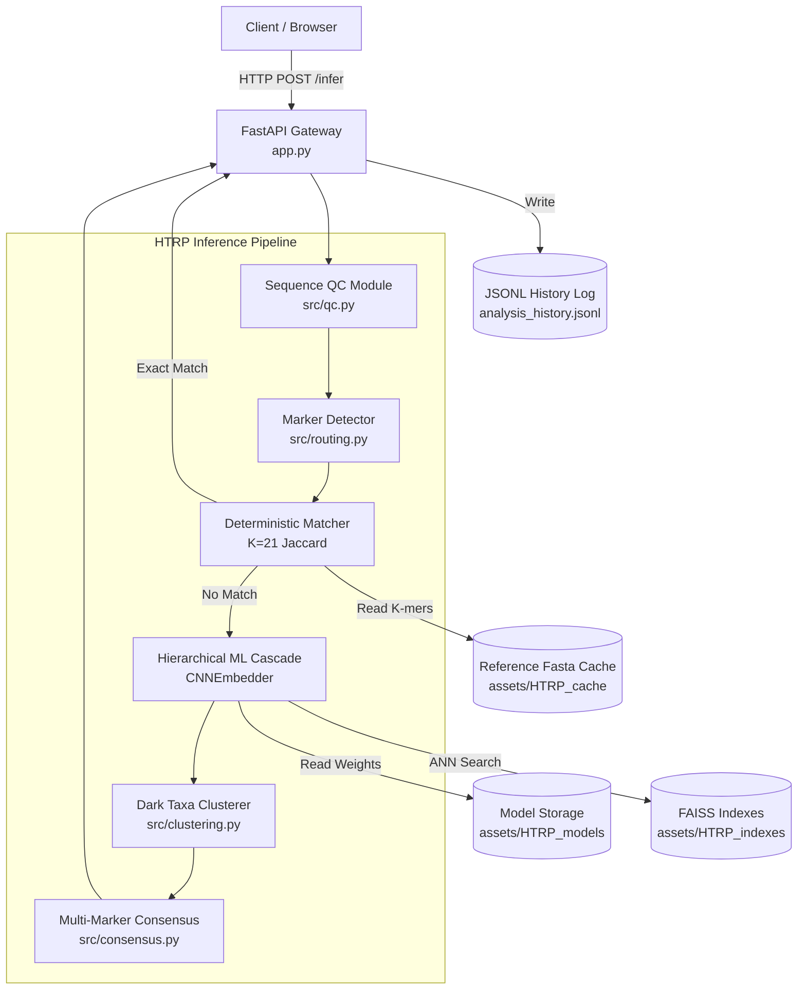
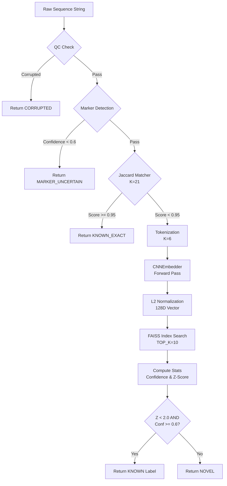

# Architecture Document: HTRP eDNA Taxonomic Classifier

This document provides a comprehensive architectural overview of the HTRP (Hierarchical Taxonomic Reference Pipeline) project. It outlines the system's high-level architecture, internal project structure, component responsibilities, data flows, observability, and performance characteristics.

---

## 1. High-Level Architecture

The following diagram illustrates the major components of the HTRP system, tracking a request from the client through the inference cascade and clustering modules.



---

## 2. Project Structure

The project follows a modular layout, dividing API entry points, core logic, training/evaluation scripts, and static assets.

```text
HTRP/
├── app.py                      # Main FastAPI application and API routing
├── hierarchical_infer.py       # Core hierarchical ML cascade pipeline
├── train.py                    # Model training script (SupCon/InfoNCE)
├── split_data.py               # Data preparation and train/test splitting
├── build_index.py              # FAISS index construction script
├── src/                        # Core application modules
│   ├── routing.py              # Marker detection model logic
│   ├── qc.py                   # Sequence quality control checks
│   ├── clustering.py           # DBSCAN-based novelty clustering
│   ├── consensus.py            # Multi-marker hierarchical consensus logic
│   └── baseline*.py            # Baseline ML models for comparison
├── assets/                     # Persistent storage for data, models, and indexes
│   ├── HTRP_models/            # Trained PyTorch CNN models
│   ├── HTRP_indexes/           # FAISS index files (index.faiss, ids.npy, meta.json)
│   └── HTRP_cache/             # Cached reference FASTA files and k-mers
├── results/                    # Output directory for benchmarks/evaluations
├── tests/                      # Unit and integration tests
├── docs/                       # Project documentation
├── analysis_history.jsonl      # Application access/inference log
├── environment.yml             # Conda environment definition
├── requirements.txt            # Python dependencies
└── README.md                   # Project summary and quickstart
```

---

## 3. Component-by-Component Explanation

### API Gateway
| Field | Description |
|---|---|
| **Type** | Web API (FastAPI) |
| **Purpose** | Serves as the primary entry point for inference requests. |
| **Responsibilities** | Validates incoming requests, handles file uploads (`/infer_batch`), orchestrates the pipeline, and returns JSON predictions. |
| **Dependencies** | `fastapi`, `uvicorn`, core `src` modules. |
| **Consumers** | Web clients, automated scripts. |
| **Failure considerations** | Request rejection on malformed inputs; returns HTTP 400. |

### Marker Detector (`src.routing.MarkerDetector`)
| Field | Description |
|---|---|
| **Type** | Machine Learning Module |
| **Purpose** | Determines the biological marker (e.g., 16S, CO1) of an unknown sequence. |
| **Responsibilities** | Parses sequences and assigns a marker label. Acts as a router to select the correct downstream models. |
| **Data** | Raw DNA sequences. |
| **Failure considerations** | If confidence is `< 0.6`, request is rejected with `MARKER_UNCERTAIN`. |

### Deterministic Matcher
| Field | Description |
|---|---|
| **Type** | Heuristic Filter |
| **Purpose** | Quickly identifies known sequences to bypass expensive ML inference. |
| **Responsibilities** | Computes 21-mer Jaccard similarity against reference sequences. |
| **Data** | Reference k-mers loaded from `assets/HTRP_cache`. |
| **Performance** | O(1) exact matching, highly performant. |

### Hierarchical ML Cascade (`hierarchical_infer.py`)
| Field | Description |
|---|---|
| **Type** | Deep Learning Inference Pipeline |
| **Purpose** | Classifies sequences hierarchically (Phylum $\to$ Class $\to$ Order $\to$ Family $\to$ Genus) while detecting OOD (Out-of-Distribution) sequences. |
| **Responsibilities** | Runs sequences through rank-specific `CNNEmbedder` models, generates 128D embeddings, searches FAISS, computes confidence and Z-scores. |
| **Dependencies** | PyTorch models (`assets/HTRP_models/`), FAISS indexes (`assets/HTRP_indexes/`). |
| **Consumers** | API Gateway (`app.py`). |

### Dark Taxa Clusterer (`src.clustering.DarkTaxaClusterer`)
| Field | Description |
|---|---|
| **Type** | Unsupervised ML Module |
| **Purpose** | Groups novel/unknown sequences into distinct clusters. |
| **Responsibilities** | Runs DBSCAN (`eps=0.30`, `min_samples=5`) on embeddings of sequences flagged as `NOVEL` with high Z-scores. |
| **Consumers** | Batch inference pipeline in `app.py`. |

---

## 4. Low-Level Architecture

This diagram illustrates the internal processing flow for a single inference request.



---

## 5. Low-Level Component Details

### Hierarchical ML Cascade / Inference
**Name:** `infer_ml` (in `app.py`) / `HierarchicalPipeline`
**Location:** `app.py` / `hierarchical_infer.py`
**Purpose:** Core machine learning classification and novelty detection.

**Input:**
* Type: String (DNA sequence)
* Format: `ACGT...`
* Validation: Padded to `MAX_SEQ_LEN` (500). Invalid characters mapped to padding.

**Processing:**
* Encodes sequence into k=6 integers (vocabulary size 4096).
* Passes through `CNNEmbedder` (two 1D convolutions, BatchNorm, AdaptiveMaxPool, Linear projection).
* Embeddings are L2 normalized.
* FAISS `IndexIVFFlat` searches for `TOP_K=10` nearest neighbors.
* Z-score is calculated dynamically using distance to nearest neighbor compared against index statistics (`mean`, `std`).

**Output:**
* Type: JSON / Dictionary
* Format: `{"prediction": "...", "confidence": 0.85, "z_score": 1.12, "neighbors": [...]}`

**Performance:**
* Expected response time: Highly performant vector search.
* The README notes the index architecture achieves ~178,000 queries/sec. Overall request time depends on model forward pass + FAISS search. 
* Actual end-to-end latency: Recorded in `timing.total` field of JSON logs (Requires runtime measurement).

---

## 6. Input $\to$ Output Flow

**Standard Classification Request (`/infer`)**

1. **Origin:** Client sends POST request to `/infer` with `sequence` and `marker`.
2. **Gateway:** FastAPI receives the request and triggers `run_pipeline()`.
3. **Validation (QC):** `sequence_qc()` checks for corruption (e.g., too many Ns). If corrupted, returns immediately.
4. **Routing:** If marker is `auto`, `MarkerDetector` classifies the sequence.
5. **Heuristic Stage:** Sequence is k-merized (k=21) and compared to reference taxa using Jaccard similarity. If $\ge 0.95$, it returns an exact match immediately.
6. **ML Stage:** If no exact match, sequence is tokenized (k=6) and passed to PyTorch `CNNEmbedder`.
7. **Vector Search:** The resulting 128D embedding is queried against FAISS `IndexIVFFlat`.
8. **Thresholding:** If prediction Confidence $\ge 0.6$ and Distance Z-score $< 2.0$, it is accepted as `KNOWN`. Otherwise, flagged as `NOVEL`.
9. **Logging:** Request parameters, timings, and prediction are appended to `analysis_history.jsonl`.
10. **Response:** JSON result is returned to the client.

---

## 7. Results, Logs, and Monitoring

**Observability Architecture**

```text
Application 
   │
   ├──► Application Logs (stdout/stderr via standard Python logging)
   │
   └──► Audit/Access Logs (analysis_history.jsonl)
```

- **Application Logs:** The system uses standard Python `logging` (level `INFO`). It logs start, progress, and end of inference requests (e.g., `[UUID] START → seq_id`, `[UUID] DONE → NOVEL (0.45s)`).
- **Access/Audit Logs:** Every inference request generates a comprehensive JSON record appended to `analysis_history.jsonl`. This log includes timestamp, marker, prediction, confidence, z-scores, and processing time.
- **Monitoring Tools:** Currently, monitoring relies entirely on local log files. There is no active metrics collector (e.g., Prometheus) or distributed tracing (e.g., Jaeger) configured in the codebase.
- **Results Visibility:** The `/history` endpoint allows users to retrieve the last 50 entries from `analysis_history.jsonl`.

---

## 8. Response Time and Performance Details

| Component/Flow | Input | Processing | Output | Response Time | Source |
|---|---|---|---|---|---|
| **Pipeline (End-to-End)** | Sequence | QC $\to$ Match $\to$ ML | JSON | Recorded per request | Measured at runtime (in JSON logs) |
| **FAISS Vector Search** | Embedding | Approximate Nearest Neighbor | Neighbors | Very Low | Configured/README (Target: ~178k QPS) |
| **Deterministic Match** | Sequence | Jaccard Overlap | Score | Fast | Source logic (in-memory sets) |

*Note: Explicit `p50`/`p99` latency metrics are not statically available in the project source. They must be aggregated from `analysis_history.jsonl` via runtime benchmarking.*

---

## 9. Error and Failure Flow

- **Malformed HTTP Requests:** Handled automatically by FastAPI with standard `422 Unprocessable Entity` responses.
- **Invalid Marker:** The API explicitly checks against `VALID_MARKERS`. Returns `400 Bad Request` if invalid.
- **Sequence Quality Failure:** Caught by `sequence_qc`. Fails gracefully by returning `prediction: "CORRUPTED"` with details, bypassing heavy ML processing.
- **Marker Uncertainty:** If `auto` marker routing yields confidence $< 0.6$, the system gracefully aborts and returns `prediction: "MARKER_UNCERTAIN"`.
- **Missing Assets:** Handled gracefully on startup. If assets are missing, a HuggingFace fallback routine is triggered to download them dynamically via `snapshot_download`.

---

## 10. Data Architecture

- **Data Sources:** Raw `.fasta` files for training and inference.
- **Data Transformation:** `split_data.py` handles dataset splits and hierarchy grouping.
- **Storage/Databases:** The system relies entirely on the local file system. 
  - **Relational Databases:** None.
  - **Vector Database:** Local FAISS binary files (`index.faiss` + `ids.npy`).
  - **In-Memory Caches:** `MODELS`, `INDEXES`, and `REFERENCE_KMERS` dictionaries in `app.py` act as lazy-loaded singletons to prevent memory exhaustion and disk I/O on every request.

---

## 11. Deployment Architecture

While Kubernetes/cloud manifests are not explicitly present in the root directory, deployment artifacts exist:
- **Environment:** Defined via `environment.yml` (Conda) and `requirements.txt` (Pip).
- **Containers:** A `Dockerfile` exists, indicating containerized deployment support. 
- **Server:** Served via Uvicorn on port `8000` (or `7860` for HuggingFace spaces overrides).
- **Assets:** Heavy ML assets are pulled automatically from Hugging Face (`chiraghariprasad/eDNA`) if not present locally, enabling seamless cold-starts in cloud environments.

---

## 12. Architecture Summary

### System Summary
The HTRP system is an edge-capable, high-performance sequence classifier. Requests are received via a FastAPI web server, funneled through deterministic quality control and marker-routing gates, and passed to a hierarchical ML cascade. The cascade utilizes custom PyTorch CNN embeddings queried against FAISS indexes to perform Search-by-Elimination. Suspicious or out-of-distribution sequences are rejected based on dynamic Z-score thresholds and funneled into a DBSCAN clustering module for novel taxa discovery.

### Key Components
| Component | Responsibility |
|---|---|
| **FastAPI Backend** | Request routing, validation, JSON formatting, batch processing. |
| **Deterministic Filter** | High-speed exact k-mer matching for known species. |
| **CNNEmbedder** | Generates rich 128D representations of k=6 tokenized sequences. |
| **FAISS Indexes** | Stores reference embeddings for lightning-fast ANN search. |
| **Dark Taxa Clusterer** | Discovers novel biodiversity clusters using DBSCAN. |

### Architecture Risks / Open Questions
- **Single Point of Failure:** The system is monolithic. All state (caches, models) resides in a single process's memory space. 
- **Memory Scaling:** Lazy loading of multi-marker FAISS indexes and CNN models into RAM (`MODELS`, `INDEXES`) could cause Out-of-Memory (OOM) errors under heavy multi-marker batch loads on constrained hardware.
- **Missing Telemetry:** There are no configured Prometheus metrics or OpenTelemetry traces. Performance monitoring relies purely on ad-hoc parsing of `analysis_history.jsonl`.
